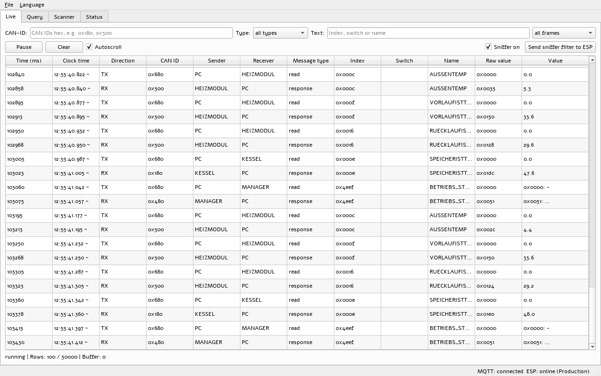

[Deutsch](docs/README.de.md)

# ha-stiebel-control-gui

PySide6 GUI for bus analysis and debug functions of the Stiebel Eltron WPL-A (Elster CAN). It talks over MQTT to the firmware from [ha-stiebel-control](https://github.com/bullitt186/ha-stiebel-control) (upstream bullitt186, topic root `heatingpump/`, see PR #138 and PR #141).

## 1. Purpose

- Monitor the CAN bus (raw frames, decoded using the Elster reference)
- Query individual Elster signals on demand
- Scan index ranges of a CAN member
- Search for participants on the bus
- Write with read-back (only after unlocking and confirmation)
- Export recordings as CSV or JSONL and reload them offline

## 2. Requirements

- Python 3 (Windows, Git Bash or PowerShell)
- Virtual environment in the repo folder:

  ```
  python -m venv .venv
  .venv\Scripts\activate
  pip install -r gui/requirements.txt
  pip install pytest
  ```

- Dependencies per `gui/requirements.txt`: PySide6, paho-mqtt (2.x API)
- Reference table `ElsterTable.json` (see section 4)

## 3. Start

From the repo root folder:

```
python -I main.py
```

`-I` is mandatory so that modules from foreign folders are not loaded.

## 4. Credentials and reference

The MQTT credentials are stored in `secrets.yaml` in the repo root folder (not in the repo, never commit). Alternatively, the path can be set via the environment variable `STIEBEL_SECRETS`. Template: copy `secrets.example.yaml` to `secrets.yaml` and fill in your values. Required keys:

- `mqtt_server`
- `mqtt_port`
- `mqtt_username`
- `mqtt_password`

The connection dialog is pre-filled with these values. The password is neither stored nor logged.

The reference table `ElsterTable.json` is described in the next subsection.

The GUI also starts without an Elster table (missing or invalid ElsterTable.json): a note appears in the status bar, and values are shown raw (hex).

### Elster table

- **Origin:** generated from a vendored copy of the upstream sources in [`upstream/`](upstream/README.md) (project bullitt186/ha-stiebel-control, pinned to commit `4ec5b3c`, hashes in `upstream/PIN.json`). The files are unchanged copies; no download is needed. Licenses: LGPL-3.0 for `ElsterTable.h`, GPL-3.0 for the upstream project, see [NOTICE](NOTICE).
- **Generate in the GUI:** **File > Generate Elster table from upstream…** Choose the model, the target file (default: `ElsterTable.<model>.json` in the config folder) and whether to add details from the private table if found. The path is saved. Restart the GUI to use the new table.
- **Generate on the command line:** `python -I tools/gen_upstream_table.py --model wpla7 --out ElsterTable.wpla7.json`. Also `--list`, `--pin` and `--all --out-dir <dir>`.
- **Search order at start:**
  1. environment variable `ELSTER_REFERENCE_JSON`,
  2. saved path of the last generated table (`config.json` in the user config folder; `STIEBEL_GUI_CONFIG_DIR` replaces that folder),
  3. private table `../elster_reference/ElsterTable.json` (optional; `../referenzen/elster_reference/ElsterTable.json` is checked as well),
  4. none: the GUI starts without a table and shows values raw (hex).
- **Private overlay (optional):** for generated tables, the private table fills the fields `owner`, `owner_name`, `poll`, `comment` and `bits` where upstream leaves them empty, and adds signals that upstream does not have (with their own name and type). Names and types stay upstream. Path: `ELSTER_PRIVATE_JSON` (if set, only this path is used). Switch: the dialog option, saved as `table_overlay` in `config.json`.
- **Duplicates:** if several rows have the same index, the first row wins, as in the upstream C++ lookup. The dropped rows are listed in `source.duplicates_dropped` of the generated file.
- **Pin update:** see [upstream/README.md](upstream/README.md).

## 5. Functions (tabs)

- **Live** (`tab_live.py`): shows CAN frames from the ESP in real time with Elster decoding, filterable by CAN ID and type.
- **Query** (`tab_query.py`): reads or writes an Elster signal via MQTT and shows the history of results. Read mode accepts several recipients separated by `;` or `,`; they are queried one after another with the same index, format and switch.
- **Scanner** (`tab_scanner.py`): queries an index range of a CAN member and shows the hit list with names from the reference.
- **Status** (`tab_status.py`): shows availability, MQTT connection and the firmware status (counters, ring buffer, TWAI errors).
- **Analysis** (`tab_analyse.py`): compares one index across several members and helps choose the type.
- **Index browser** (`tab_index_browser.py`): shows all indices of a measurement with a comparison against the reference.

### Screenshots



The images show synthetic demo data, not a live connection. Descriptions of all tabs and dialogs: [docs/SCREENSHOTS.md](docs/SCREENSHOTS.md) (German: [docs/SCREENSHOTS.de.md](docs/SCREENSHOTS.de.md)).

## 6. Tests

```
python -I -m pytest tests
```

The tests run without a broker; the MQTT transport is replaced by fakes. They use a checked-in excerpt of the Elster table (`tests/data/ElsterTable.test.json`, LGPL-3.0, from ElsterTable.h); no private reference file is needed.

## 7. Language

The GUI is available in English (default) and German. Choose it in the menu **Language**; the choice is saved and applies after restarting the application. `STIEBEL_GUI_LANG=de` (or `en`) overrides the saved choice for one run.

Add a language: copy the key list with `python -I tools/i18n_check.py --keys`, translate the values into `gui/locales/<code>.json` (keep the `{placeholders}` unchanged), add the code to `LANGUAGE_NAMES` in `gui/i18n.py`, then check with `python -I tools/i18n_check.py` (missing, unused keys, placeholder mismatch). In code, user-visible text is wrapped as `_("English text")`; the English text is the key. Tests always run in English.

## 8. Note on debug mode

The debug firmware mode (topic prefix `stiebel-debug/`) is legacy. The goal is the upstream API (`heatingpump/…`, interface described in [docs/INTERFACES.md](docs/INTERFACES.md), section 13).

## 9. License

GPL-3.0, see [LICENSE](LICENSE).
