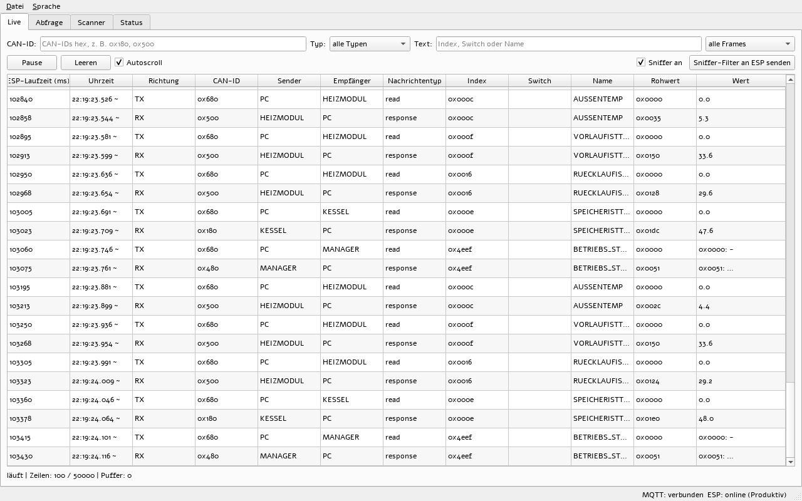
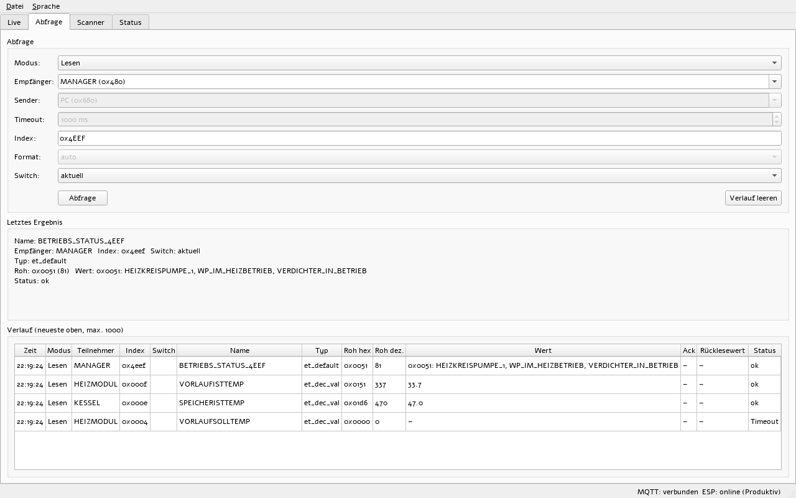
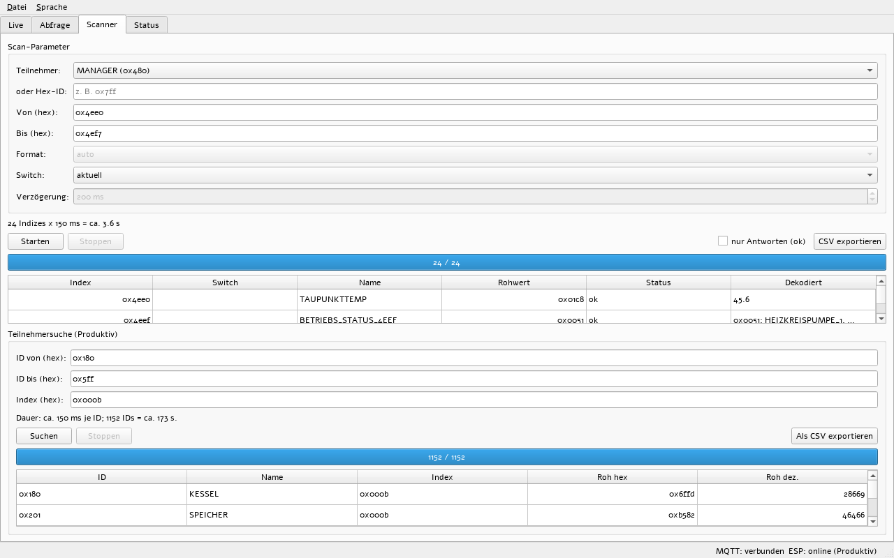
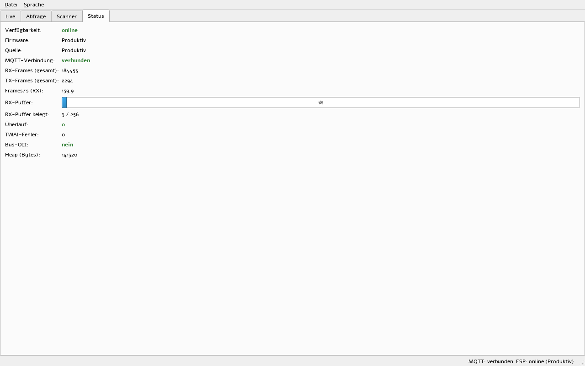
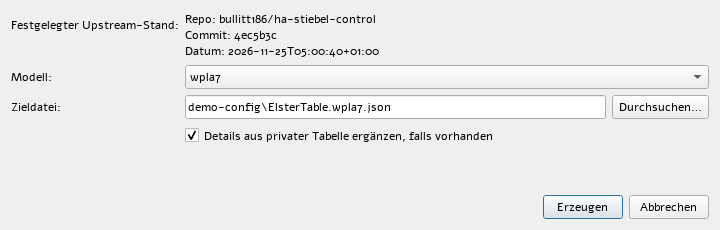
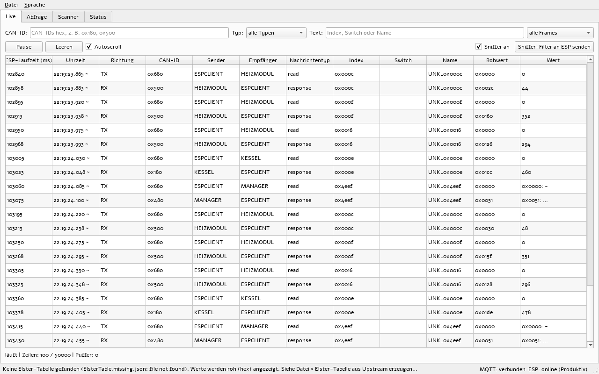

[English](SCREENSHOTS.md)

# Screenshots

Die Bilder zeigen die deutsche Oberfläche (Sprache **Sprache > Deutsch**) mit
synthetischen Demo-Daten. Es war keine echte MQTT-Verbindung
aktiv. Die Bilder entstehen mit `tools/make_screenshots.py`. Neu erzeugen
(Windows, PySide6 nötig, Schriften aus dem Windows-Fontordner):

```
.venv/Scripts/python.exe -I tools/make_screenshots.py --lang de
```

## 01 Tab Live



Der Tab Live zeigt CAN-Frames vom ESP in Echtzeit, mit Richtung, Sender,
Empfänger, Art der Nachricht, Index, Name, Rohwert und dekodiertem Wert. Mit den
Filtern für CAN-ID und Art sowie dem Textfeld (Index, Schalter oder Name) wird die
Liste eingegrenzt. Der Modus „letzter Wert je Index“ zeigt nur den neuesten Frame
je Sender, Index und Schalter. „Sniffer an“ und „Sniffer-Filter an ESP senden“
steuern den Sniffer im ESP.

## 02 Tab Abfrage



Der Tab Abfrage liest bei Bedarf ein Elster-Signal eines oder mehrerer Members.
Das Beispiel liest Index 0x4EEF von MANAGER (0x480). Man wählt Empfänger, Index
(Hex oder Signalname), Format und Schalter (aktuell, min, max oder alle).
Mehrere Empfänger trennt man mit `;` oder `,`; sie werden nacheinander mit
demselben Index, Format und Schalter abgefragt. „Letztes Ergebnis“ zeigt je
Empfänger eine Zeile mit dem dekodierten Wert und dem Status, der Verlauf behält
die letzten Ergebnisse, neueste oben. Der Schreibmodus liegt im selben Tab und
nimmt genau einen Empfänger. Vor dem Senden eines Werts fragt die GUI nach einer
Bestätigung.

## 03 Tab Scanner



Der Tab Scanner fragt einen Index-Bereich eines CAN-Members ab und listet die
Treffer mit Namen aus der Referenztabelle. „nur Antworten (ok)“ blendet leere
Antworten aus, „CSV exportieren“ speichert die Liste. Die Zeitschätzung zeigt die
erwartete Dauer vor dem Start. Der untere Teil „Teilnehmersuche (Produktiv)“ sucht
im CAN-ID-Bereich nach Teilnehmern, die auf einen Index antworten. Ein
Doppelklick auf einen Treffer kopiert dessen ID in das Feld des Scanners.

## 04 Tab Status



Der Tab Status zeigt, ob die Firmware online ist, die MQTT-Verbindung, die Art
der Firmware, die Zähler für RX- und TX-Frames und die Frames pro Sekunde. Dazu
kommen die Füllung des RX-Puffers, der Überlaufzähler, der TWAI-Fehlerzähler, das
Bus-Off-Flag und der freie Heap. Damit prüft man den Zustand des ESP. Steigende
TWAI-Fehler, Bus-Off „JA“, ein Überlauf über 0 oder ein voller RX-Puffer deuten
auf ein Problem am Bus oder in der Firmware hin.

## 05 Dialog „Elster-Tabelle aus Upstream erzeugen“



Aufruf über **Datei > Elster-Tabelle aus Upstream erzeugen…**. Der Dialog zeigt
den gepinnten Upstream-Stand (Repo, Commit, Datum). Man wählt das Modell (hier
wpla7), die Zieldatei und ob Details aus der privaten Tabelle ergänzt werden,
falls vorhanden. Die Tabelle entsteht aus der eingecheckten Upstream-Kopie, ein
Download ist nicht nötig. Nach dem Erzeugen die GUI neu starten, um die neue
Tabelle zu nutzen.

## 06 Start ohne Elster-Tabelle



Beim ersten Start gibt es noch keine `ElsterTable.json`. Die GUI startet trotzdem.
Die Statusleiste meldet, dass keine Tabelle gefunden wurde, und verweist auf
**Datei > Elster-Tabelle aus Upstream erzeugen…**. Bis eine Tabelle erzeugt ist,
werden die Werte roh angezeigt: Namen als `UNK_0x<index>`, Werte ohne Skalierung
(z. B. Vorlauftemperatur 0x000f mit 352 statt 35.2).
