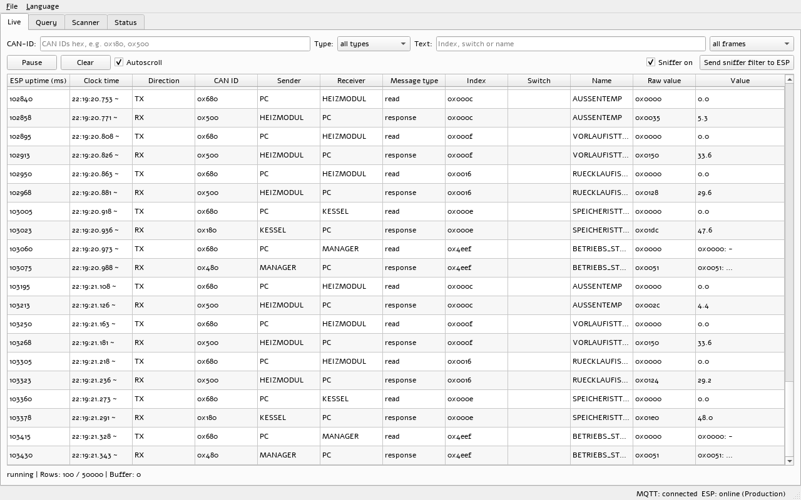
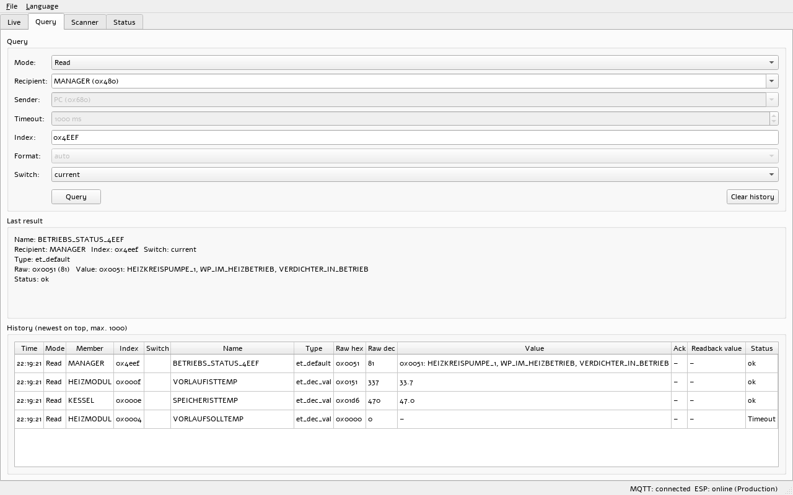
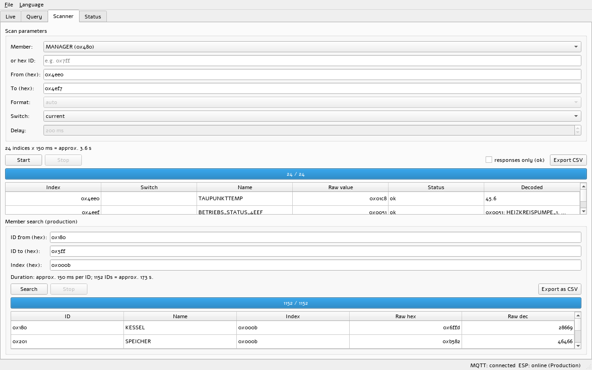
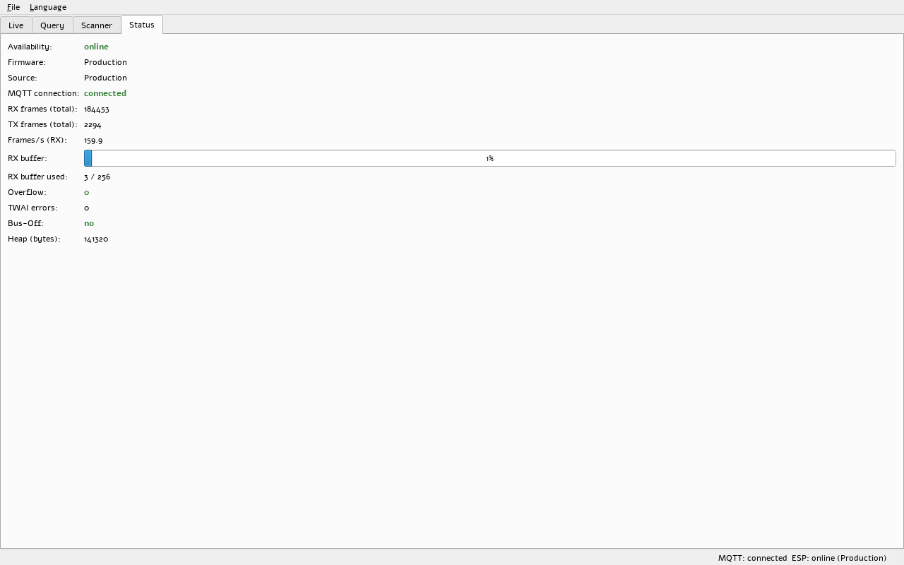
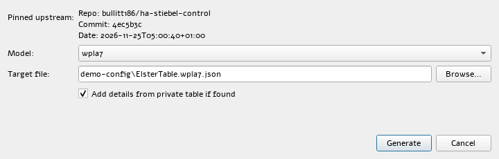
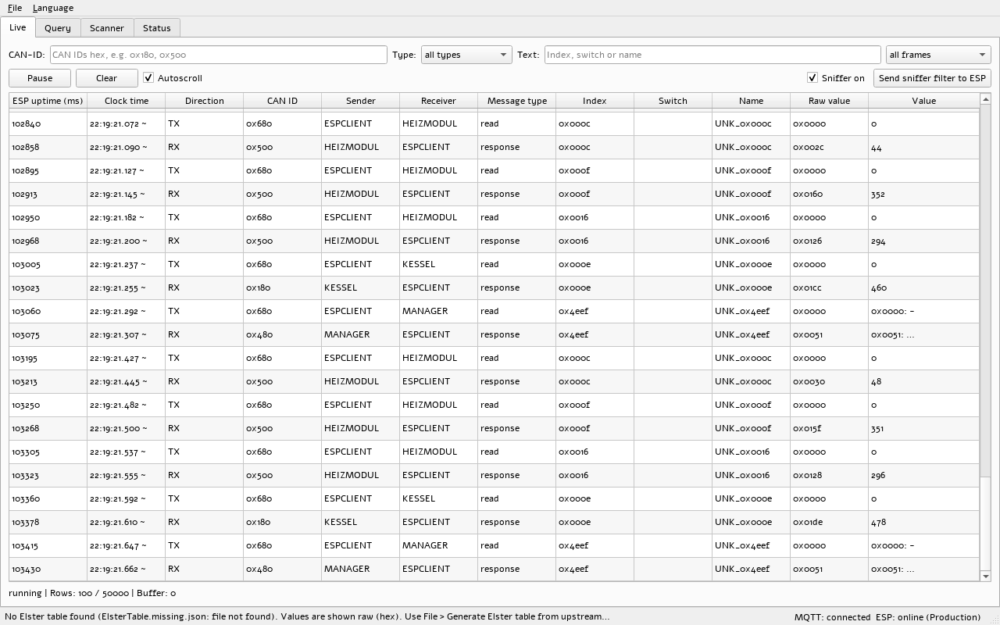

[Deutsch](SCREENSHOTS.de.md)

# Screenshots

The images show synthetic demo data. No real MQTT connection was used. The
images are generated by `tools/make_screenshots.py`. To regenerate them
(Windows, PySide6 required, fonts are taken from the Windows font folder):

```
.venv/Scripts/python.exe -I tools/make_screenshots.py
.venv/Scripts/python.exe -I tools/make_screenshots.py --lang de
```

The second command writes the German images to `screenshots/de/` for
[SCREENSHOTS.de.md](SCREENSHOTS.de.md).

## 01 Live tab



The Live tab shows CAN frames from the ESP in real time, with direction, sender,
receiver, message type, index, name, raw value and decoded value. Use the CAN-ID
and type filters and the text field (index, switch or name) to narrow the list.
The mode "last value per index" shows only the newest frame per sender, index and
switch. "Sniffer on" and "Send sniffer filter to ESP" control the sniffer on the
ESP.

## 02 Query tab



The Query tab reads one Elster signal from one or more members on demand. The
example reads index 0x4EEF from MANAGER (0x480). Choose the recipient(s), the
index (hex or signal name), the format and the switch (current, min, max or all).
Several recipients are separated by `;` or `,` and are queried one after another
with the same index, format and switch. "Last result" shows one line per
recipient with the decoded value and status, and "History" keeps the recent
results, newest on top. Write mode is on the same tab and takes exactly one
recipient. Before a value is sent, the GUI asks for confirmation.

## 03 Scanner tab



The Scanner tab queries an index range of one CAN member and lists the hits with
names from the reference table. "responses only (ok)" hides empty answers, and
"Export CSV" saves the list. The estimate shows the expected duration before the
scan starts. The lower part, "Member search (production)", searches the CAN ID
range for members that answer to one index. Double-click on a result copies its
ID into the scanner field.

## 04 Status tab



The Status tab shows whether the firmware is online, the MQTT connection, the
firmware kind, the RX and TX frame counters and the frames per second. It also
shows the RX buffer fill, the overflow counter, the TWAI error counter, the Bus-Off
flag and the free heap. Use it to check the health of the ESP. Rising TWAI errors,
Bus-Off "YES", an overflow above 0 or a full RX buffer point to a problem on the
bus or in the firmware.

## 05 Dialog "Generate Elster table from upstream"



Opened from **File > Generate Elster table from upstream...**. The dialog shows
the pinned upstream repository, commit and date. Choose the model (here wpla7),
the target file and whether details from the private table are added if they
exist. The table is generated from the vendored upstream copy, so no download is
needed. Restart the GUI to use the new table.

## 06 Start without Elster table



On a first start, no `ElsterTable.json` exists yet. The GUI still starts. The
status bar explains that no table was found and points to **File > Generate
Elster table from upstream...**. Until a table is generated, values are shown
raw: names as `UNK_0x<index>`, values without scaling (for example, the flow
temperature 0x000f shows 352 instead of 35.2).
